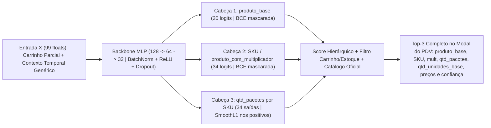
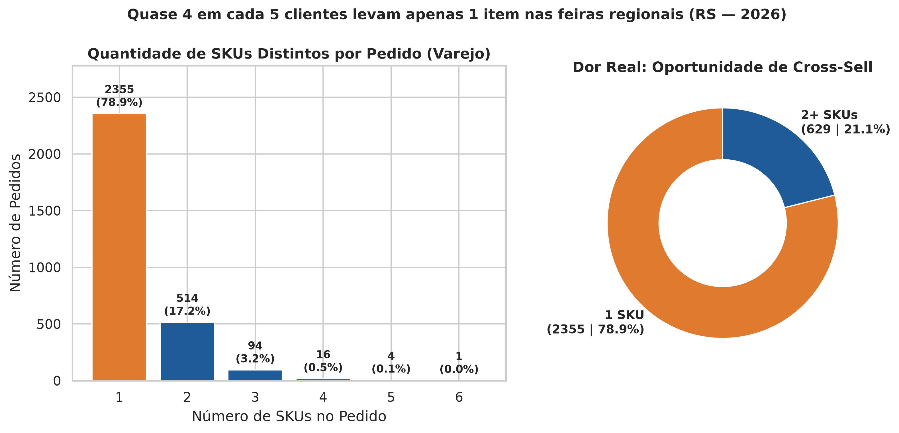
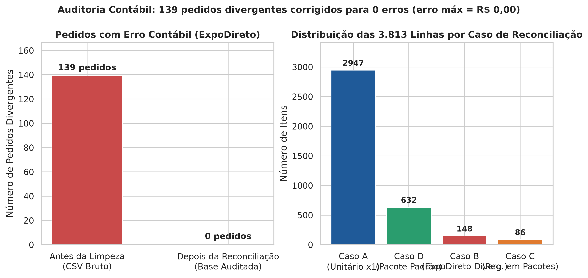
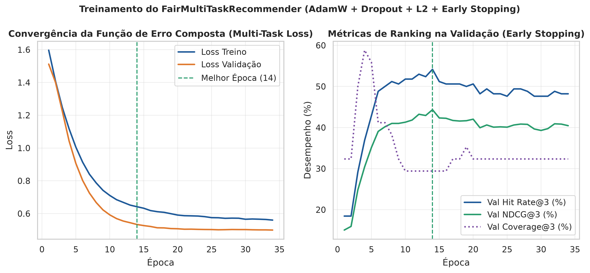
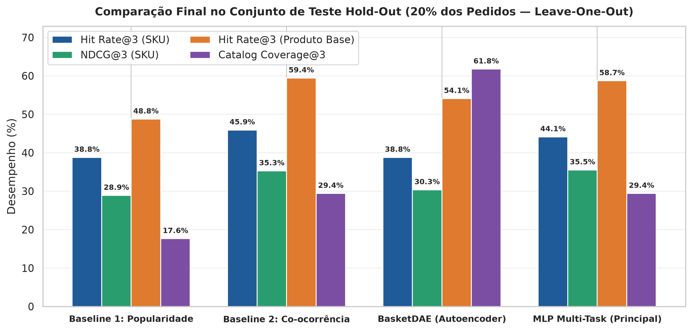
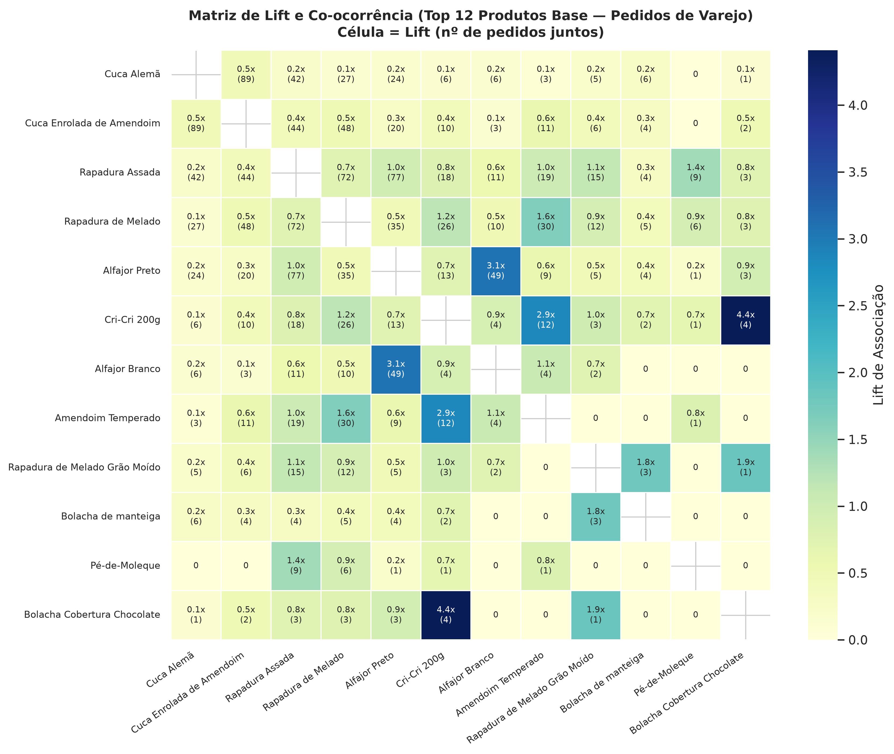

# Feira PDV IA — Sistema de Recomendação para Produtos de Feiras com Rede Neural

> **Trabalho 2 — Inteligência Artificial II (2026/02)**  
> **Instituição:** Faculdade Antonio Meneghetti (AMF) — Sistemas de Informação  
> **Modalidade:** Modalidade 1 — Treinamento de Rede Neural Própria  
> **Documentação Técnica Modular:** [docs/README.md](docs/README.md)

---

## 1. O Problema Real

A partir de dados reais de vendas em **16 feiras regionais do Rio Grande do Sul em 2026** (`dataset.csv`: `3.815` itens distribuídos em `3.003` pedidos únicos), a auditoria inicial identificou uma dor comercial clara:

- **78,9% dos pedidos de balcão (2.355 de 2.984)** possuem **apenas 1 SKU** (79,0% no nível de produto base).
- Apenas **21,1% (629 pedidos)** possuem 2 ou mais SKUs distintos, com ticket médio de **R$ 26,26**.
- Durante o atendimento rápido no balcão da feira, o vendedor não consegue lembrar manualmente quais combinações de produtos e embalagens (`Unidade`, `Pacote x3`, `Pacote x4`, `Pacote x6`, `Fardo x3`...) têm maior afinidade — e precisa de uma solução **genérica** que funcione em **qualquer feira nova**, respeitando o estoque disponível no dia.

### Qualidade e Auditoria dos Dados Reais
Antes de treinar qualquer modelo, o pipeline em **funções puras matemáticas** (`src/utils/cleaning.py` + `src/data/preprocessing.py`) resolveu anomalias reais de PDV:
- **Descontos validados (0 erros):** comprovação matemática de que 100% dos 3.003 pedidos armazenam descontos em R$ (inclusive o único pedido marcado com `%` e valor `0.12` na `EXPOBENTO`), permitindo remover com segurança `pedido_tipo_desconto`, `pedido_vendedor` e `item_pedido_user_id`.
- **Reconciliação contábil (`139 → 0` erros):** correção determinística de **139 pedidos divergentes** + 11 registros em pacotes na `ExpoDireto` e dos formatos sem `xN` da `1 Moranguinho`, atingindo **erro contábil máximo de R$ 0,000000** e **0 quantidades de pacotes fracionárias**.
- **Catálogo normalizado (`58 → 34 SKUs / 20 produtos base`):** saneamento de espaços, remoção de 2 itens com `quantidade == 0`, isolamento de 18 pedidos consolidados/fechamento de caixa (`is_pedido_consolidado`) e proteção estrita contra fusão indevida de produtos distintos.

---

## 2. Arquitetura da Solução e Rede Neural Multi-Task

Em vez de prever atributos redundantes em um vetor plano (que poderia gerar combinações impossíveis como embalagens inexistentes ou `qtd_unidades_base != qtd_pacotes × multiplicador`), desenvolvemos em **PyTorch** o **`FairMultiTaskRecommender`** — uma **Rede Neural MLP Multi-Cabeça Genérica** (`dim = 99`, sem dependência de `evento_nome`) combinada a uma camada determinística de catálogo e **pós-processamento por estoque (`available_skus`)**:



### Destaques Técnicos (Alinhados à Disciplina)
- **Split 80/20 estrito por `pedido_id` (zero *data leakage*):** 80% Desenvolvimento (`2.387` pedidos; `503` multi-SKU, com sub-split interno de validação para *Early Stopping* e *Optuna*) e 20% Teste Hold-Out intocado (`597` pedidos; `126` multi-SKU $\rightarrow$ `281` casos Leave-One-Out).
- **Expansão por Subconjuntos Próprios Únicos ($2^k - 2$):** gera `1.350` exemplos de cross-sell multi-label sem duplicatas no treino (`+ 162` exemplos de *cold-start* para carrinho vazio), permitindo gerar o **Top-3 em uma única passada (*forward pass*)**.
- **Função de Erro Composta Mascarada (`src/modeling/losses.py`):** `BCEWithLogitsLoss` com máscara nos itens já presentes no carrinho + `pos_weight` calibrado + `SmoothL1Loss` (Huber) exclusivamente nos SKUs positivos.
- **Regularização, Otimizador e Tuning:** `AdamW` (regularização L2), `BatchNorm1d`, `Dropout`, `ReduceLROnPlateau`, `EarlyStopping` e busca de hiperparâmetros com **Optuna** (30 *trials*).
- **Pós-processamento de Estoque no Top-$K$:** ao receber `available_skus` do PDV, itens esgotados são zerados antes do recorte Top-3, pulando automaticamente para o próximo SKU disponível no ranking.
- **Exportação Versionada + Stack Full-Stack:** artefatos em `models/recommender_v1/` (`model_weights.pt`, `preprocessing_artifacts.joblib`, `catalog_metadata.json`, `training_report.json`), servidos por **FastAPI (`api/main.py`)** para o **PDV em React + Vite + TypeScript (`front/`)** com **Modal Top-3 ao finalizar venda**.

---

## 3. Resultados no Conjunto de Teste Hold-Out (20%)

Comparação imparcial dos 4 modelos treinados e avaliados sobre exatamente o mesmo split (`281` casos Leave-One-Out nos `126` pedidos multi-SKU de Teste):

| Modelo | Hit Rate@1 (SKU) | Hit Rate@3 (SKU) | NDCG@3 (SKU) | MRR (SKU) | Coverage@3 | Hit Rate@3 (Base) | Qtd MAE | Qtd Exata |
| :--- | :---: | :---: | :---: | :---: | :---: | :---: | :---: | :---: |
| **Baseline 1: Popularidade** | 16,0% | 38,8% | 28,9% | 34,5% | 17,7% | 48,8% | 0,413 | 76,5% |
| **Baseline 2: Co-ocorrência** | 21,0% | **45,9%** | 35,3% | 39,6% | 29,4% | **59,4%** | 0,416 | 76,2% |
| **BasketDAE (Autoencoder)** | 19,2% | 38,8% | 30,4% | 35,9% | **61,8%** | 54,1% | **0,413** | **76,5%** |
| **MLP Multi-Task (Principal)** | **23,8%** | 44,1% | **35,5%** | **40,3%** | 29,4% | 58,7% | 0,420 | 75,4% |

- O **`FairMultiTaskRecommender`** alcançou o **1º lugar em `Hit Rate@1` (23,8% — ganho relativo de +48,9% sobre Popularidade)**, **1º lugar em `NDCG@3` (35,5%)** e **1º lugar em `MRR` (40,3%)**, além de **58,7% de acerto no Top-3 em produto base** e **75,4% de acurácia exata** na quantidade de pacotes recomendada.
- Exemplos reais de predições no conjunto de teste estão documentados em [reports/qualitative_cases.md](reports/qualitative_cases.md).

### Evidências Visuais

| Dor de Negócio (78,9% pedidos unitários) | Auditoria Contábil (`139 → 0` erros) |
| :---: | :---: |
|  |  |

| Curvas de Treinamento (Early Stopping) | Comparação Final no Teste (20%) |
| :---: | :---: |
|  |  |



---

## 4. Estrutura do Repositório

```text
ia-g2/
├── README.md                          # Documentação principal
├── requirements.txt                   # Dependências Python fixadas
├── dataset.csv                        # Dataset bruto original (imutável)
├── docs/                              # Planejamento modular das 8 etapas (ver docs/README.md)
├── data/processed/                    # Base auditada (.parquet + espelhos .csv), cestas e splits 80/20
├── notebooks/                         # Notebooks .ipynb executados passo a passo (01, 02 e 03)
├── src/                               # Código modular em 4 camadas + orquestrador
│   ├── config.py                      # Constantes, seeds, mapas canônicos e caminhos
│   ├── pipeline.py                    # Orquestrador ponta-a-ponta (python -m src.pipeline)
│   ├── utils/                         # Camada 1: funções puras matemáticas (cleaning, temporal, baskets, ranking)
│   ├── data/                          # Camada 2: pipeline de dados (preprocessing, features, eda, dataset_builder)
│   ├── modeling/                      # Camada 3: ML/DL (baselines, models, losses, evaluate, train)
│   └── serving/                       # Camada 4: produção (export, inference)
├── models/recommender_v1/             # Pacote versionado exportado do modelo PyTorch
├── api/main.py                        # API REST FastAPI servindo o modelo exportado
├── front/                             # Interface PDV em React + Vite + TypeScript (Modal Top-3 + Simulador de Estoque)
├── reports/                           # Figuras PNG (300 DPI), auditorias JSON, métricas CSV e casos qualitativos
└── tests/                             # Suite automatizada pytest (50 testes)
```

---

## 5. Como Reproduzir e Executar o Projeto Passo a Passo

### Pré-requisitos
- **Python 3.11+** (validado em Python 3.14)
- **Node.js 20+** e `npm` (para o frontend React + Vite)

### 5.1 Configurar o Ambiente Python
```bash
python3 -m venv .venv
source .venv/bin/activate
pip install --upgrade pip
pip install -r requirements.txt
# Opcional para PyTorch CPU leve:
# pip install torch==2.15.0+cpu --index-url https://download.pytorch.org/whl/cpu
```

### 5.2 Executar o Pipeline Completo (do CSV Bruto ao Modelo Exportado)

**Opção A — Orquestrador Único (recomendado):**
```bash
python -m src.pipeline                # Executa todas as etapas (1 -> 7) ponta-a-ponta
python -m src.pipeline --skip-train   # Reprocessa dados, EDA, splits e reexporta o checkpoint atual
python -m src.pipeline --only-data    # Executa apenas a camada de dados (Etapas 1 -> 4)
```

**Opção B — Execução Individual por Etapa:**
```bash
python -m src.data.preprocessing     # Etapa 1: limpeza em funções puras + itens_limpos.parquet (139 -> 0 erros)
python -m src.data.features          # Etapa 2: features + pedidos_cestas.parquet + catalog_metadata.json
python -m src.data.eda               # Etapa 3: 6 gráficos em reports/figures/ + eda_summary.json
python -m src.data.dataset_builder   # Etapa 4: split 80/20 anti-leakage + subconjuntos 2^k-2
python -m src.modeling.train         # Etapas 5 & 6: Optuna (30 trials) + MLP + DAE + Baselines + avaliação (20%)
python -m src.serving.export         # Etapa 7: exportação versionada em models/recommender_v1/
```

### 5.3 Rodar a Suite de Testes Automatizados (`50` testes)
```bash
pytest -v
```

### 5.4 Subir a API FastAPI + Interface PDV (React + Vite)

**Terminal 1 — Backend FastAPI (porta 8000):**
```bash
source .venv/bin/activate
uvicorn api.main:app --reload --port 8000
```

**Terminal 2 — Frontend PDV React + Vite (porta 5173):**
```bash
cd front
npm install
npm run dev
```
Acesse **`http://localhost:5173`** no navegador:
1. Monte um carrinho clicando nos produtos do catálogo (produtos com múltiplas embalagens abrem o modal de apresentação).
2. *(Opcional)* Clique em **"Estoque (34/34)"** no topo e marque algum produto como esgotado para testar o pós-processamento pulando itens sem estoque.
3. Clique em **"Finalizar Venda (Ver Top-3 IA)"** para abrir o **Modal de Recomendação IA**, visualizar os 3 itens completos (produto base, SKU/embalagem, multiplicador, qtd pacotes, qtd unitária, preços e afinidade %), adicionar ao carrinho ou concluir a venda simulada.

### 5.5 Exemplo Direto via `curl` (`POST /api/recommend`)
```bash
curl -X POST http://127.0.0.1:8000/api/recommend \
  -H "Content-Type: application/json" \
  -d '{
    "cart_items": [{"sku_norm": "Alfajor Preto (x1)", "qtd_pacotes": 2}],
    "hora": 15,
    "dia_semana": 5,
    "top_k": 3
  }'
```
