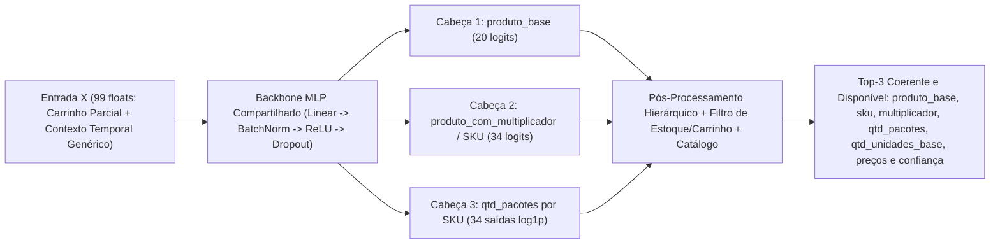

[← Etapa Anterior: Dataset e Split](4_dataset_e_split.md) | [Índice](README.md) | [Próxima Etapa: Avaliação →](6_avaliacao.md)

# Etapa 5 — Baselines, Modelagem Neural Multi-Task Genérica, Autoencoder e Tuning

| Campo | Detalhe |
| :--- | :--- |
| **Objetivo** | Implementar os baselines estatísticos, a rede neural principal Multi-Task genérica (`dim = 99`, 3 cabeças + pós-processamento com filtro de estoque), o modelo comparativo Denoising Autoencoder e o ajuste de hiperparâmetros com Optuna |
| **Módulos & Notebooks** | `src/baselines.py`, `src/models.py`, `src/losses.py`, `src/train.py`, `notebooks/03_treino_e_avaliacao.ipynb` |
| **Testes** | `tests/test_model_and_export.py` (*forward pass*, máscara da loss e filtro de estoque Top-$K$) |
| **Entradas** | `data/processed/splits/`, `models/recommender_v1/catalog_metadata.json` |
| **Saídas** | Checkpoints de treino, `reports/figures/07_curvas_treinamento.png`, histórico de *trials* Optuna |
| **Referência Teórica** | [material_neural_network.pdf](../material_neural_network.pdf) |
| **Status** | `[x] Concluído` |

---

## 1. Baselines Não-Neurais Obrigatórios (`src/baselines.py`)
Para demonstrar cientificamente o valor agregado da rede neural, implementamos dois baselines genéricos usando exatamente o mesmo split 80/20:
1. **Baseline 1 — Popularidade Global:** ranqueia os SKUs mais frequentes no conjunto de treino (excluindo itens já no carrinho e itens fora de estoque), prevendo `qtd_pacotes = 1` (moda global = 80,7%).
2. **Baseline 2 — Matriz de Co-ocorrência / Regras de Associação (Confiança e Lift):** dado o conjunto de SKUs no carrinho, soma a pontuação condicional $P(s_j \mid s_i)$ (com suavização de Laplace) e prevê a mediana histórica de `qtd_pacotes` para o SKU recomendado.

## 2. Por Que Rede Neural Multi-Task (Multi-Cabeça) em vez de Alvo Plano?
A proposta inicial previa 5 atributos no alvo (`produto_base`, `produto_com_multiplicador`, `multiplicador`, `qtd_pacotes`, `qtd_unidades_base`). Prever os 5 como saídas independentes causaria redundância funcional e risco de previsões fisicamente impossíveis (como sugerir embalagem inexistente ou `qtd_unidades_base != qtd_pacotes × multiplicador`).

A solução adotada preserva **100% dos 5 atributos na recomendação final**, estruturada em **3 cabeças especializadas** + **pós-processamento determinístico com filtro de estoque**:

## 3. Modelo Principal — `FairMultiTaskRecommender` (PyTorch)
Alinhado diretamente aos conceitos da Aula 10 ([material_neural_network.pdf](../material_neural_network.pdf)):
- **Arquitetura (`src/models.py` — `torch.nn.Module`):**
  - *Backbone Feedforward:* `Linear(99, 128) → BatchNorm1d(128) → ReLU → Dropout(0.30) → Linear(128, 64) → BatchNorm1d(64) → ReLU → Dropout(0.20)`.
  - *Cabeça 1 (`head_base`):* `Linear(64, 20)` — logits multi-label para os 20 `produto_base`.
  - *Cabeça 2 (`head_sku`):* `Linear(64, 34)` — logits multi-label para os 34 `produto_com_multiplicador` (`sku_norm`).
  - *Cabeça 3 (`head_qty`):* `Linear(64, 34)` + `Softplus` (garante saída $\ge 0$ em escala `log1p(qtd_pacotes)`).
- **Função de Erro (`src/losses.py` — `MultiTaskRecommendationLoss`):**
  $$\mathcal{L}_{\text{total}} = w_1 \cdot \mathcal{L}_{\text{BCE}}^{\text{masked}}(\hat{y}_{\text{base}}, y_{\text{base}}) + w_2 \cdot \mathcal{L}_{\text{BCE}}^{\text{masked}}(\hat{y}_{\text{sku}}, y_{\text{sku}}) + w_3 \cdot \mathcal{L}_{\text{SmoothL1}}^{\text{pos}}(\hat{y}_{\text{qty}}, y_{\text{qty}})$$
  - `BCEWithLogitsLoss` com `pos_weight` moderado ($\sqrt{N_{\text{neg}}/N_{\text{pos}}}$ limitado a um teto) para evitar colapso apenas nos 3 itens mais populares.
  - Máscara na *loss* de classificação excluindo SKUs já presentes no carrinho.
  - `SmoothL1Loss` (Huber) aplicada **somente nos índices positivos (`y_sku == 1`)**, calibrando a previsão de `qtd_pacotes` exclusivamente sobre itens efetivamente comprados.
- **Otimizador, Regularização e Convergência (`src/train.py`):**
  - Otimizador **`torch.optim.AdamW`** (`lr=1e-3`, `weight_decay=1e-4` para regularização L2).
  - Scheduler **`ReduceLROnPlateau`** monitorando `val_ndcg@3`.
  - **`EarlyStopping`** (paciência de 15–20 épocas) sobre o sub-split de validação interno (dentro dos 80% de Desenvolvimento) para evitar *overfitting* sem tocar no Teste (20%).

### 3.1 Exemplo Numérico Passo a Passo: Como o Pedido Entra ($X$) e Sai ($Y$) da Rede
Suponha um pedido real às **15h de sábado** com 2 itens: `Alfajor Preto (x1)` (`2` pacotes, R$ 12,00) + `Rapadura Assada (x6)` (`1` pacote, R$ 25,00). No exemplo de treino em que mascaramos `Rapadura Assada (x6)` como alvo:
1. **Montagem do vetor de entrada `X` (`99` floats):**
   - `x_cart_sku_bin` (`34`): tudo `0`, exceto `1.0` na posição de `Alfajor Preto (x1)`.
   - `x_cart_sku_qty` (`34`): tudo `0`, exceto `log1p(2) = 1.098` na posição de `Alfajor Preto (x1)`.
   - `x_cart_base_bin` (`20`): tudo `0`, exceto `1.0` na posição de `Alfajor Preto`.
   - `x_cart_stats` (`5`, escalonado): `[qtd_skus=1, log1p(2), log1p(2), log1p(12.0), tem_pacote=0]`.
   - `x_time` (`6`): `[sin(15h)=-0.71, cos(15h)=-0.71, manha=0, tarde=1, noite=0, fim_de_semana=1]`.
2. **Passagem na rede (*forward pass*):** `X (99) → h1 (128) → h2 (64)` se bifurca nas 3 cabeças:
   - `head_base (20)` + `Sigmoid` $\rightarrow$ probabilidade dos 20 produtos base (ex.: `Rapadura Assada = 0.78`).
   - `head_sku (34)` + `Sigmoid` $\rightarrow$ probabilidade dos 34 SKUs (ex.: `Rapadura Assada (x6) = 0.72`).
   - `head_qty (34)` $\rightarrow$ na posição de `Rapadura Assada (x6)` sai `0.69` $\rightarrow$ `max(1, round(expm1(0.69))) = 1` pacote.
3. **Treino (*loss + backpropagation*):** compara as 3 cabeças com o gabarito (`y_base[Rapadura Assada]=1`, `y_sku[Rapadura Assada (x6)]=1`, `y_qty[Rapadura Assada (x6)]=0.693`), ignora `Alfajor Preto (x1)` via máscara na loss e ajusta os pesos com `AdamW`.
4. **Inferência no PDV:** a mesma passada gera o ranking completo dos 34 SKUs em milissegundos, aplica os filtros abaixo e devolve o **Top-3** ao modal.

## 4. Pós-Processamento Hierárquico + Filtro de Estoque no Top-$K$
Na inferência, dado o carrinho atual e a lista opcional de SKUs em estoque na feira (`available_skus`):
1. Aplicamos `sigmoid` nos logits: $p_{\text{base}} = \sigma(\hat{y}_{\text{base}})$ e $p_{\text{sku}} = \sigma(\hat{y}_{\text{sku}})$.
2. Calculamos o score hierárquico de cada SKU candidato $s$:
   $$\text{score}(s) = p_{\text{sku}}(s)^{1-\lambda} \cdot p_{\text{base}}(\text{base}(s))^{\lambda} \quad (\lambda \in [0, 0.5] \text{ ajustado na validação})$$
3. **Aplicação de Máscaras Operacionais (antes de recortar Top-$K$):**
   - **Máscara do carrinho:** zera o score de qualquer SKU já presente em `cart_items`.
   - **Máscara de estoque/disponibilidade da feira:** se `available_skus` for informado pelo PDV, qualquer SKU fora de estoque (ou não levado para aquela feira) é zerado — fazendo o ranking **pular automaticamente para o próximo SKU disponível** até preencher o Top-$K$!
4. Para cada um dos **Top-$K$ SKUs disponíveis**, reconstruímos o objeto completo via `catalog_metadata.json`:
   - `produto_com_multiplicador`, `produto_base`, `tipo_embalagem`, `multiplicador`
   - `qtd_pacotes = max(1, int(round(np.expm1(y_qty_hat[sku]))))`
   - `qtd_unidades_base = qtd_pacotes * multiplicador`
   - `preco_unitario`, `preco_pacote`, `valor_estimado = qtd_pacotes * preco_pacote`, `confianca = score(s)`.

## 5. Modelo Neural Comparativo — Denoising Autoencoder (`BasketDAE`)
Conectado diretamente ao **Slide 42** de [material_neural_network.pdf](../material_neural_network.pdf) (*Autoencoder — representação comprimida / denoising*):
- Arquitetura: `Encoder: (34 + 6) → 64 → 24 (bottleneck)` e `Decoder: 24 → 64 → 34`.
- Recebe cestas corrompidas por ruído de mascaramento (*masking noise* = 30%–50%) e aprende a reconstruir a cesta completa, permitindo comparar **Baselines Estatísticos vs. Autoencoder (DAE) vs. MLP Multi-Task Genérico**.

## 6. Ajuste de Hiperparâmetros (Slide 43)
- Estudo estruturado com **Optuna** (25–40 *trials* rápidos em CPU) sobre o bloco de **80% Desenvolvimento** otimizando `val_ndcg@3` (SKU):
  - Arquitetura do *backbone*: `[(64, 32), (128, 64), (128, 64, 32)]`
  - `learning_rate` $\in [3\times 10^{-4}, 5\times 10^{-3}]$, `dropout` $\in [0.1, 0.45]$, `weight_decay` $\in [10^{-5}, 10^{-2}]$, `batch_size` $\in \{32, 64, 128\}$, pesos $(w_1, w_2, w_3)$ e fator $\lambda$.
- Salvar gráfico de curvas de aprendizado (`reports/figures/07_curvas_treinamento.png`).

> **Extensão Opcional (Pós-MVP, se sobrar tempo após tudo pronto):** rodar estudo de ablação comparando o **Modelo Genérico (sem `evento_nome`)** contra uma variante **Com `evento_nome` (`dim ≈ 114`)** em validação *Leave-Last-Events-Out*.

---

## Critérios de Pronto (*Definition of Done*)
- [x] Baselines, `FairMultiTaskRecommender` (genérico, `dim = 99`) e `BasketDAE` treinados sobre o mesmo split 80/20 de `pedido_id`.
- [x] Filtro pós-processamento de estoque (`available_skus`) validado pulando itens indisponíveis para o próximo no ranking.
- [x] Curvas de *loss* (treino vs. validação) salvas em `reports/figures/07_curvas_treinamento.png` e exibidas em `notebooks/03_treino_e_avaliacao.ipynb`.
- [x] Estudo Optuna concluído e testes de *forward pass*, máscara da loss e filtro de estoque passando 100%.
