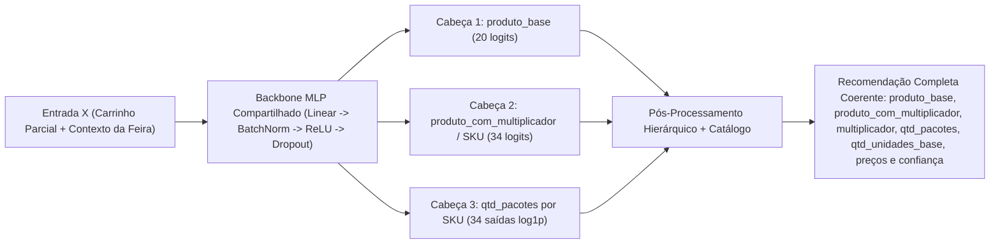

[← Etapa Anterior: Dataset e Split](4_dataset_e_split.md) | [Índice](README.md) | [Próxima Etapa: Avaliação →](6_avaliacao.md)

# Etapa 5 — Baselines, Modelagem Neural Multi-Task, Autoencoder e Tuning

| Campo | Detalhe |
| :--- | :--- |
| **Objetivo** | Implementar os baselines estatísticos, a rede neural principal Multi-Task (3 cabeças), o modelo comparativo Denoising Autoencoder e o ajuste de hiperparâmetros com Optuna |
| **Módulos** | `src/baselines.py`, `src/models.py`, `src/losses.py`, `src/train.py` |
| **Testes** | `tests/test_model_and_export.py` (testes de *forward pass* e máscara da loss) |
| **Entradas** | `data/processed/splits/`, `models/recommender_v1/catalog_metadata.json` |
| **Saídas** | Checkpoints de treino, `reports/figures/07_curvas_treinamento.png`, histórico de *trials* Optuna |
| **Referência Teórica** | [material_neural_network.pdf](../material_neural_network.pdf) |
| **Status** | `[ ] Planejado` |

---

## 1. Baselines Não-Neurais Obrigatórios (`src/baselines.py`)
Para demonstrar cientificamente o valor agregado da rede neural, implementamos dois baselines fortes usando exatamente o mesmo split e protocolo de avaliação:
1. **Baseline 1 — Popularidade (Global e por Feira):** ranqueia os SKUs mais frequentes no conjunto de treino (excluindo itens já no carrinho), prevendo `qtd_pacotes = 1` (moda global = 80,7%).
2. **Baseline 2 — Matriz de Co-ocorrência / Regras de Associação (Confiança e Lift):** dado o conjunto de SKUs no carrinho, soma a pontuação condicional $P(s_j \mid s_i)$ (com suavização de Laplace) e prevê a mediana histórica de `qtd_pacotes` para o SKU recomendado.

## 2. Por Que Rede Neural Multi-Task (Multi-Cabeça) em vez de Alvo Plano?
A proposta inicial previa 5 atributos no alvo (`produto_base`, `produto_com_multiplicador`, `multiplicador`, `qtd_pacotes`, `qtd_unidades_base`). Prever os 5 como saídas independentes causaria redundância funcional e risco de previsões fisicamente impossíveis (como sugerir embalagem inexistente ou `qtd_unidades_base != qtd_pacotes × multiplicador`).

A solução adotada preserva **100% dos 5 atributos na recomendação final**, mas estruturada em **3 cabeças especializadas** + **derivação determinística pelo catálogo**:

## 3. Modelo Principal — `FairMultiTaskRecommender` (PyTorch)
Alinhado diretamente aos conceitos da Aula 10 ([material_neural_network.pdf](../material_neural_network.pdf)):
- **Arquitetura (`src/models.py` — `torch.nn.Module`):**
  - *Backbone Feedforward:* `Linear(in_dim, 128) → BatchNorm1d(128) → ReLU → Dropout(0.30) → Linear(128, 64) → BatchNorm1d(64) → ReLU → Dropout(0.20)`.
  - *Cabeça 1 (`head_base`):* `Linear(64, 20)` — logits multi-label para os 20 `produto_base`.
  - *Cabeça 2 (`head_sku`):* `Linear(64, 34)` — logits multi-label para os 34 `produto_com_multiplicador` (`sku_norm`).
  - *Cabeça 3 (`head_qty`):* `Linear(64, 34)` + `Softplus` (garante saída $\ge 0$ em escala `log1p(qtd_pacotes)`).
- **Função de Erro (`src/losses.py` — `MultiTaskRecommendationLoss`):**
  $$\mathcal{L}_{\text{total}} = w_1 \cdot \mathcal{L}_{\text{BCE}}^{\text{masked}}(\hat{y}_{\text{base}}, y_{\text{base}}) + w_2 \cdot \mathcal{L}_{\text{BCE}}^{\text{masked}}(\hat{y}_{\text{sku}}, y_{\text{sku}}) + w_3 \cdot \mathcal{L}_{\text{SmoothL1}}^{\text{pos}}(\hat{y}_{\text{qty}}, y_{\text{qty}})$$
  - `BCEWithLogitsLoss` com `pos_weight` moderado ($\sqrt{N_{\text{neg}}/N_{\text{pos}}}$ limitado a um teto) para evitar colapso apenas nos 3 itens mais populares.
  - Máscara na *loss* de classificação excluindo SKUs já presentes no carrinho (o modelo só aprende a prever itens faltantes).
  - `SmoothL1Loss` (Huber) aplicada **somente nos índices positivos (`y_sku == 1`)**, calibrando a previsão de `qtd_pacotes` exclusivamente sobre itens efetivamente comprados.
- **Otimizador, Regularização e Convergência (`src/train.py`):**
  - Otimizador **`torch.optim.AdamW`** (`lr=1e-3`, `weight_decay=1e-4` para regularização L2).
  - Scheduler **`ReduceLROnPlateau`** monitorando `val_ndcg@3`.
  - **`EarlyStopping`** (paciência de 15–20 épocas) restaurando o melhor checkpoint de validação para evitar *overfitting*.
  - Registro completo de `train_loss`, `val_loss` (total e por cabeça) e `val_ndcg@3` por época.

## 4. Combinação Hierárquica e Pós-Processamento Determinístico
Na inferência, dado o carrinho atual:
1. Aplicamos `sigmoid` nos logits: $p_{\text{base}} = \sigma(\hat{y}_{\text{base}})$ e $p_{\text{sku}} = \sigma(\hat{y}_{\text{sku}})$.
2. Zeramos o score dos SKUs já presentes no carrinho (e aplicamos penalização suave opcional caso o mesmo `produto_base` já esteja no carrinho).
3. Calculamos o score hierárquico de cada SKU candidato $s$:
   $$\text{score}(s) = p_{\text{sku}}(s)^{1-\lambda} \cdot p_{\text{base}}(\text{base}(s))^{\lambda} \quad (\lambda \in [0, 0.5] \text{ ajustado na validação})$$
4. Selecionamos os **Top-$K$ SKUs** e reconstruímos a recomendação **100% coerente**:
   - `produto_com_multiplicador` = `sku_norm`
   - `produto_base` = `catalog[sku]["produto_base"]`
   - `multiplicador` = `catalog[sku]["multiplicador"]`
   - `qtd_pacotes` = `max(1, int(round(np.expm1(y_qty_hat[sku]))))`
   - `qtd_unidades_base` = `qtd_pacotes * multiplicador`
   - `preco_unitario`, `preco_pacote`, `valor_estimado = qtd_pacotes * preco_pacote`
   - `confianca` = `score(s)`

## 5. Modelo Neural Comparativo — Denoising Autoencoder (`BasketDAE`)
Conectado diretamente ao **Slide 42** de [material_neural_network.pdf](../material_neural_network.pdf) (*Autoencoder — representação comprimida / denoising*):
- Arquitetura: `Encoder: (34 + ctx) → 64 → 24 (bottleneck)` e `Decoder: 24 → 64 → 34`.
- Recebe cestas corrompidas por ruído de mascaramento (*masking noise* = 30%–50%) e aprende a reconstruir a cesta completa, permitindo comparar **Baselines Estatísticos vs. Autoencoder (DAE) vs. MLP Multi-Task Context-Aware**.

## 6. Ajuste de Hiperparâmetros (Slide 43)
- Estudo estruturado com **Optuna** (25–40 *trials* rápidos em CPU) otimizando `val_ndcg@3` (SKU) sobre:
  - Arquitetura do *backbone*: `[(64, 32), (128, 64), (128, 64, 32)]`
  - `learning_rate` $\in [3\times 10^{-4}, 5\times 10^{-3}]$
  - `dropout` $\in [0.1, 0.45]$
  - `weight_decay` $\in [10^{-5}, 10^{-2}]$
  - `batch_size` $\in \{32, 64, 128\}$
  - Pesos da *loss* $(w_1, w_2, w_3)$ e fator hierárquico $\lambda$.
- Salvar gráfico de curvas de aprendizado (`reports/figures/07_curvas_treinamento.png`) e tabela dos melhores hiperparâmetros.

---

## Critérios de Pronto (*Definition of Done*)
- [ ] Baselines (Popularidade e Co-ocorrência/Lift), `FairMultiTaskRecommender` e `BasketDAE` treinados sobre exatamente o mesmo split de `pedido_id`.
- [ ] Curvas de *loss* (treino vs. validação) salvas em `reports/figures/07_curvas_treinamento.png` sem *overfitting* severo ou `NaN`.
- [ ] Estudo Optuna concluído com hiperparâmetros vencedores registrados.
- [ ] Testes de *forward pass*, dimensões das 3 cabeças e mascaramento da loss passando 100%.
