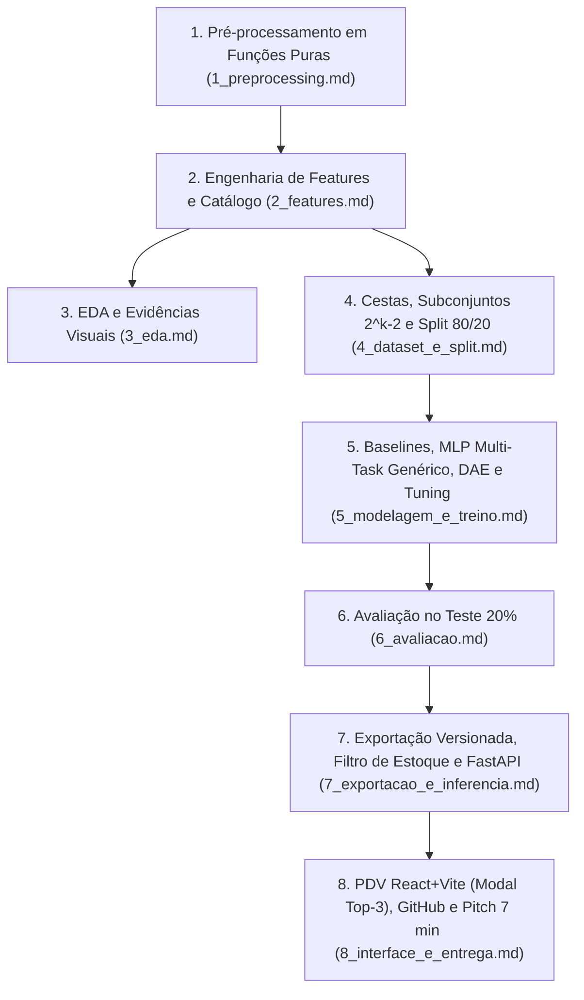

# Plano de Desenvolvimento — Sistema de Recomendação para Produtos de Feiras com Rede Neural

> **Disciplina:** Inteligência Artificial II (2026/02) — Faculdade Antonio Meneghetti (AMF) — Sistemas de Informação  
> **Modalidade:** Modalidade 1 — Treinamento de Rede Neural Própria  
> **Prazo de Entrega:** 23/11/2026 (segunda-feira) às 12h00  
> **Referências do Projeto:** [dataset.csv](../dataset.csv) | [descricao_trabalho.pdf](../descricao_trabalho.pdf) | [material_neural_network.pdf](../material_neural_network.pdf)

---

## Índice da Documentação

Cada etapa abaixo é uma especificação autocontida, mapeada diretamente aos módulos de código, notebooks e testes do projeto.

| # | Documento | Escopo da Etapa | Módulos, Notebooks & Testes | Saída Principal | Status |
| :-: | :--- | :--- | :--- | :--- | :-: |
| **1** | [1_preprocessing.md](1_preprocessing.md) | Funções puras de auditoria, validação de descontos, reconciliação contábil (`139 → 0`), outliers e tipagem | `src/config.py`, `src/utils/cleaning.py`, `src/data/preprocessing.py`, `notebooks/01_*.ipynb`, `tests/test_preprocessing.py` | `data/processed/itens_limpos.{parquet,csv}` | `[x]` |
| **2** | [2_features.md](2_features.md) | Features de produto, embalagem/multiplicador, preço, contexto temporal e catálogo oficial (`20 bases / 34 SKUs`) | `src/utils/temporal.py`, `src/data/features.py`, `notebooks/01_*.ipynb`, `tests/test_features.py` | `data/processed/pedidos_cestas.{parquet,csv}`, `catalog_metadata.json` | `[x]` |
| **3** | [3_eda.md](3_eda.md) | Análise exploratória e geração de 6 evidências visuais para `README.md`, notebooks e pitch | `src/data/eda.py`, `notebooks/02_*.ipynb` | `reports/figures/01_*.png` .. `06_*.png` | `[x]` |
| **4** | [4_dataset_e_split.md](4_dataset_e_split.md) | Split **80/20** anti-leakage por `pedido_id`, expansão por subconjuntos ($2^k - 2$), modelo genérico (`dim = 99`) e tensores `X / Y` | `src/utils/baskets.py`, `src/data/dataset_builder.py`, `tests/test_dataset_split.py` | `data/processed/splits/` | `[x]` |
| **5** | [5_modelagem_e_treino.md](5_modelagem_e_treino.md) | Baselines, MLP Multi-Task (3 cabeças, genérico), filtro de estoque Top-$K$, `BasketDAE` e Optuna | `src/modeling/baselines.py`, `src/modeling/models.py`, `src/modeling/losses.py`, `src/modeling/train.py`, `notebooks/03_*.ipynb` | Checkpoints + `07_curvas_treinamento.png` | `[x]` |
| **6** | [6_avaliacao.md](6_avaliacao.md) | Avaliação no Hold-Out (20%): métricas Top-$K$, `Catalog Coverage@3`, erro de `qtd_pacotes` e casos qualitativos | `src/utils/ranking.py`, `src/modeling/evaluate.py` | `reports/evaluation_summary.csv`, `08_comparacao_modelos.png` | `[x]` |
| **7** | [7_exportacao_e_inferencia.md](7_exportacao_e_inferencia.md) | Empacotamento versionado do modelo, `RecommenderService` (com filtro de estoque) e API REST **FastAPI** | `src/serving/export.py`, `src/serving/inference.py`, `api/main.py`, `tests/test_model_and_export.py` | `models/recommender_v1/` + API REST | `[x]` |
| **8** | [8_interface_e_entrega.md](8_interface_e_entrega.md) | Frontend **React + Vite** (PDV com venda simulada + Modal Top-3), `pytest`, GitHub e pitch (7 min) | `front/`, `README.md`, `tests/` | PDV funcional + Repositório pronto | `[x]` |

---

## Visão Macro do Fluxo de Desenvolvimento



---

## Contexto, Dor de Negócio e Objetivo do Projeto

### 1. Diagnóstico do Problema Real
O conjunto de dados [dataset.csv](../dataset.csv) registra vendas reais realizadas ao longo de **2026** em **16 feiras regionais do Rio Grande do Sul** (como *Expointer_2026*, *Expo Afubra*, *Wolksfest Agudo*, *ExpoDireto*, *EXPOBENTO*, *Festa do Moranguinho*, *ExpoRestinga*, *FENAROZ*, entre outras), estruturado em nível de item (`3.815 linhas` distribuídas em `3.003 pedidos únicos`).

A auditoria inicial dos dados revelou uma **oportunidade comercial concreta e mensurável**:
- **79,0% dos pedidos (2.373 de 3.003)** contêm apenas **1 produto base** (`78,9%` no varejo em nível de SKU).
- Apenas **21,1% dos pedidos de balcão (629 pedidos)** contêm **2 ou mais SKUs normalizados**.
- No ritmo acelerado de atendimento em feiras, o vendedor raramente tem tempo para lembrar quais combinações de produtos e embalagens mais saem juntas — e precisa de um modelo **genérico**, pronto para operar em qualquer feira nova respeitando o estoque disponível no dia.

### 2. Proposta de Valor da Solução
Construir um **Sistema de Recomendação Genérico para PDV de Feiras baseado em Rede Neural Multi-Task**, integrado à interface de PDV em **React + Vite**, capaz de — no momento de finalizar a venda — analisar o carrinho atual e abrir um **Modal com Top-3 recomendações completas** (pulando automaticamente produtos sem estoque na feira):
- **`produto_base`** (família do produto, ex.: *Rapadura Assada*);
- **`produto_com_multiplicador`** (embalagem/SKU canônico ideal, ex.: *Rapadura Assada (Pacote x6)*);
- **`multiplicador`** (unidades por embalagem, ex.: `6`);
- **`qtd_pacotes`** (quantas embalagens sugerir, ex.: `1`);
- **`qtd_unidades_base`** (total de unidades individuais, ex.: `6`, garantido por `qtd_pacotes × multiplicador`);
- **`preco_unitario`, `preco_pacote` e `confiança da IA (%)`** para apoiar o cross-sell no balcão e elevar o **ticket médio** e o **número de itens por pedido**.

### 3. Aderência Acadêmica
- **Eixo Técnico ([descricao_trabalho.pdf](../descricao_trabalho.pdf) e [material_neural_network.pdf](../material_neural_network.pdf)):** implementação própria em **PyTorch** com definição explícita da arquitetura neural (*MLP Feedforward Multi-Cabeça* + comparativo com *Denoising Autoencoder*), função de custo composta mascarada, regularização (`L2` + `Dropout`), retropropagação (*backpropagation*), otimizador (`AdamW`), busca de hiperparâmetros, comparação rigorosa contra baselines estatísticos, **exportação versionada do modelo**, API **FastAPI** e interface **React + Vite**.
- **Eixo Criativo e Aplicado:** dor real comprovada por dados reais regionais, tratamento forense em funções puras de anomalias contábeis reais de PDV, pós-processamento inteligente por estoque disponível e PDV real adaptado pronto para demonstração ao vivo no *pitch* de 7 minutos.

---

## Arquitetura de Diretórios e Ambiente Reprodutível

### 1. Estrutura de Pastas do Repositório

```text
ia-g2/
├── README.md                          # Documentação principal (problema, arquitetura, execução, resultados)
├── requirements.txt                   # Dependências Python fixadas para reprodutibilidade
├── dataset.csv                        # Dataset bruto original (imutável / somente leitura)
├── docs/                              # Planejamento modular por etapa (este diretório)
│   ├── README.md                      # Índice mestre e visão macro
│   ├── 1_preprocessing.md             # Etapa 1: funções puras de limpeza, auditoria contábil e tipagem
│   ├── 2_features.md                  # Etapa 2: engenharia de features e catálogo oficial
│   ├── 3_eda.md                       # Etapa 3: análise exploratória e gráficos
│   ├── 4_dataset_e_split.md           # Etapa 4: cestas, subconjuntos 2^k-2, split 80/20 e tensores
│   ├── 5_modelagem_e_treino.md        # Etapa 5: baselines, MLP Multi-Task, DAE, filtro de estoque e tuning
│   ├── 6_avaliacao.md                 # Etapa 6: métricas Top-K no Hold-Out (20%) e casos qualitativos
│   ├── 7_exportacao_e_inferencia.md   # Etapa 7: exportação versionada, RecommenderService e FastAPI
│   └── 8_interface_e_entrega.md       # Etapa 8: frontend React+Vite (Modal Top-3), testes, GitHub e pitch
├── data/
│   └── processed/                     # Dados limpos e prontos (evita reprocessar o CSV a cada treino)
│       ├── itens_limpos.parquet       # Base auditada em nível de item (preserva tipagem exata)
│       ├── itens_limpos.csv           # Espelho CSV para visualização rápida de itens_limpos
│       ├── pedidos_cestas.parquet     # Base consolidada em nível de pedido/cesta
│       ├── pedidos_cestas.csv         # Espelho CSV para visualização rápida de pedidos_cestas
│       └── splits/                    # Índices fixos 80/20 por pedido_id
├── notebooks/                         # Notebooks .ipynb para visualização passo a passo de cada etapa
│   ├── 01_preprocessamento_e_features.ipynb
│   ├── 02_eda_e_cestas.ipynb
│   └── 03_treino_e_avaliacao.ipynb
├── src/                               # Arquitetura em 4 camadas acíclicas + orquestrador
│   ├── config.py                      # Constantes, seeds, mapas canônicos e caminhos
│   ├── pipeline.py                    # Orquestrador ponta-a-ponta (python -m src.pipeline)
│   ├── utils/                         # Camada 1: funções puras matemáticas (sem I/O)
│   │   ├── cleaning.py                # Regras puras de saneamento, descontos e reconciliação contábil
│   │   ├── temporal.py                # Codificação cíclica de hora, faixas, fim de semana e economia %
│   │   ├── baskets.py                 # Combinatória 2^k-2, LOO e vetorização X/Y (dim=99)
│   │   └── ranking.py                 # Combinação hierárquica, máscaras de estoque e métricas Top-K
│   ├── data/                          # Camada 2: pipeline de processamento de dados
│   │   ├── preprocessing.py           # Etapa 1: orquestração da auditoria e itens_limpos.parquet
│   │   ├── features.py                # Etapa 2: pedidos_cestas.parquet e catalog_metadata.json
│   │   ├── eda.py                     # Etapa 3: geração dos 6 gráficos e eda_summary.json
│   │   └── dataset_builder.py         # Etapa 4: split 80/20 anti-leakage e tensores .npz
│   ├── modeling/                      # Camada 3: baselines, redes PyTorch, treino e avaliação
│   │   ├── baselines.py               # Etapa 5: Popularidade e Co-ocorrência/Lift
│   │   ├── models.py                  # Etapa 5: FairMultiTaskRecommender (MLP) e BasketDAE
│   │   ├── losses.py                  # Etapa 5: MultiTaskRecommendationLoss mascarada
│   │   ├── evaluate.py                # Etapa 6: benchmarks (Baselines + DAE) e avaliação comparativa no Teste 20%
│   │   └── train.py                   # Etapa 5: treino dedicado do MLP Multi-Task, early stopping e busca Optuna
│   └── serving/                       # Camada 4: exportação e inferência em produção
│       ├── export.py                  # Etapa 7: serialização versionada do modelo e artefatos
│       └── inference.py               # Etapa 7: RecommenderService (inferência + filtro de estoque)
├── api/
│   └── main.py                        # Etapa 7: API REST leve em FastAPI servindo o modelo exportado
├── front/                             # Etapa 8: PDV em React + Vite + TypeScript (catálogo mocado, venda simulada e Modal Top-3)
│   └── src/                           # Componentes PDV, cliente API, simulador de estoque e modais
├── models/
│   └── recommender_v1/
│       ├── model_weights.pt           # Pesos treinados (PyTorch state_dict)
│       ├── preprocessing_artifacts.joblib  # Scalers e vocabulários
│       ├── catalog_metadata.json      # Mapeamento oficial SKU -> base, embalagem, mult, preços
│       └── training_report.json       # Hiperparâmetros, seed, curvas e métricas finais
├── reports/
│   └── figures/                       # Gráficos PNG para README, notebooks e pitch
└── tests/
    ├── test_preprocessing.py          # Testes das funções puras e da integridade contábil
    ├── test_features.py               # Testes de multiplicador, quantidades e preços
    ├── test_dataset_split.py          # Testes anti-data-leakage (split 80/20 por pedido_id)
    └── test_model_and_export.py       # Testes de forward, máscara, filtro de estoque, exportação e API
```

### 2. Sobre `data/processed/` e o Formato `.parquet`
- O diretório **`data/processed/`** armazena os conjuntos de dados intermediários já limpos e validados, mantendo [dataset.csv](../dataset.csv) intacto como fonte bruta imutável e evitando re-executar todo o ETL a cada experimento.
- Utilizamos **Apache Parquet (`.parquet`)** como fonte de leitura do pipeline porque preserva **100% da tipagem** (`datetime64` com fuso horário, `int64`, `float64`, `category`, `bool`), é mais rápido para leitura/escrita no `pandas` (via `pyarrow`) e ocupa menos espaço. Em paralelo, cada etapa gera automaticamente um **espelho `.csv`** (`itens_limpos.csv` e `pedidos_cestas.csv`, em UTF-8) para inspeção visual imediata no editor ou no GitHub.

### 3. Diretrizes de Reprodutibilidade
- Ambiente Python isolado (`python3 -m venv .venv`) com dependências fixadas em `requirements.txt` (`pandas`, `numpy`, `scikit-learn`, `torch`, `optuna`, `joblib`, `plotly`, `matplotlib`, `fastapi`, `uvicorn`, `pytest`, `pyarrow`, `jupyter`), validado em **Python 3.14**.
- Frontend **React + Vite + TypeScript** em `front/` com `package.json` isolado (Node 24).
- *Seeds* determinísticas (`SEED = 42`) em `random`, `numpy` e `torch`.
- Detalhamento do cronograma até **23/11/2026 às 12h00** e checklist final: consultar [8_interface_e_entrega.md](8_interface_e_entrega.md).
