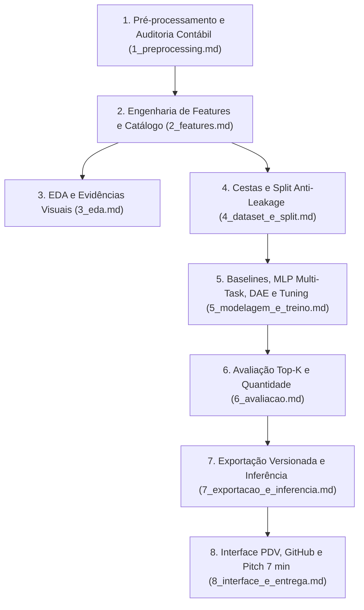

# Plano de Desenvolvimento — Sistema de Recomendação para Produtos de Feiras com Rede Neural

> **Disciplina:** Inteligência Artificial II (2026/02) — Faculdade Antonio Meneghetti (AMF) — Sistemas de Informação  
> **Modalidade:** Modalidade 1 — Treinamento de Rede Neural Própria  
> **Prazo de Entrega:** 23/11/2026 (segunda-feira) às 12h00  
> **Referências do Projeto:** [dataset.csv](../dataset.csv) | [descricao_trabalho.pdf](../descricao_trabalho.pdf) | [material_neural_network.pdf](../material_neural_network.pdf)

---

## Índice da Documentação

Cada etapa abaixo é uma especificação autocontida, mapeada diretamente aos módulos de código e testes do projeto.

| # | Documento | Escopo da Etapa | Módulos & Testes | Saída Principal | Status |
| :-: | :--- | :--- | :--- | :--- | :-: |
| **1** | [1_preprocessing.md](1_preprocessing.md) | Auditoria, validação de descontos, reconciliação contábil (`139 → 0`), outliers e tipagem | `src/config.py`, `src/preprocessing.py`, `tests/test_preprocessing.py` | `data/processed/itens_limpos.parquet` | `[ ]` |
| **2** | [2_features.md](2_features.md) | Features de produto, embalagem/multiplicador, preço, contexto e catálogo oficial (`20 bases / 34 SKUs`) | `src/features.py`, `tests/test_features.py` | `data/processed/pedidos_cestas.parquet`, `catalog_metadata.json` | `[ ]` |
| **3** | [3_eda.md](3_eda.md) | Análise exploratória e geração de 6 evidências visuais para `README.md` e pitch | `src/eda.py` | `reports/figures/01_*.png` .. `06_*.png` | `[ ]` |
| **4** | [4_dataset_e_split.md](4_dataset_e_split.md) | Split anti-leakage por `pedido_id`, mascaramento de cestas, cold-start e tensores `X / Y` | `src/dataset_builder.py`, `tests/test_dataset_split.py` | `data/processed/splits/` | `[ ]` |
| **5** | [5_modelagem_e_treino.md](5_modelagem_e_treino.md) | Baselines estatísticos, MLP Multi-Task (3 cabeças), Loss mascarada, `AdamW`, `BasketDAE` e Optuna | `src/baselines.py`, `src/models.py`, `src/losses.py`, `src/train.py` | Checkpoints + `07_curvas_treinamento.png` | `[ ]` |
| **6** | [6_avaliacao.md](6_avaliacao.md) | Métricas Top-$K$, `Catalog Coverage@3`, erro de `qtd_pacotes` e análise qualitativa | `src/evaluate.py` | `reports/evaluation_summary.csv`, `08_comparacao_modelos.png` | `[ ]` |
| **7** | [7_exportacao_e_inferencia.md](7_exportacao_e_inferencia.md) | Empacotamento versionado do modelo, contrato JSON do `RecommenderService` e alerta de upsell | `src/export.py`, `src/inference.py`, `tests/test_model_and_export.py` | `models/recommender_v1/` | `[ ]` |
| **8** | [8_interface_e_entrega.md](8_interface_e_entrega.md) | App Streamlit (PDV), suite `pytest`, checklist GitHub, pitch (7 min) e cronograma | `app/streamlit_app.py`, `README.md` | App funcional + Repositório pronto | `[ ]` |

---

## Visão Macro do Fluxo de Desenvolvimento



---

## Contexto, Dor de Negócio e Objetivo do Projeto

### 1. Diagnóstico do Problema Real
O conjunto de dados [dataset.csv](../dataset.csv) registra vendas reais realizadas ao longo de **2026** em **16 feiras regionais do Rio Grande do Sul** (como *Expointer_2026*, *Expo Afubra*, *Wolksfest Agudo*, *ExpoDireto*, *EXPOBENTO*, *Festa do Moranguinho*, *ExpoRestinga*, *FENAROZ*, entre outras), estruturado em nível de item (`3.815 linhas` distribuídas em `3.003 pedidos únicos`).

A auditoria inicial dos dados revelou uma **oportunidade comercial concreta e mensurável**:
- **79,0% dos pedidos (2.373 de 3.003)** contêm apenas **1 produto base**.
- Apenas **21,0% dos pedidos (630 no total; 619 no varejo de balcão)** contêm **2 ou mais produtos base** (e 630 pedidos de balcão contêm $\ge 2$ SKUs normalizados).
- No ritmo acelerado de atendimento em feiras, o vendedor raramente tem tempo para lembrar quais combinações de produtos e embalagens mais saem juntas em cada evento e horário.

### 2. Proposta de Valor da Solução
Construir um **Sistema de Recomendação Inteligente para PDV de Feiras baseado em Rede Neural Multi-Task**, capaz de receber os itens já selecionados no carrinho (e o contexto da feira/horário) e sugerir em tempo real o **próximo produto complementar completo**:
- **`produto_base`** (família do produto, ex.: *Rapadura Assada*);
- **`produto_com_multiplicador`** (embalagem/SKU canônico ideal, ex.: *Rapadura Assada (Pacote x6)*);
- **`multiplicador`** (unidades por embalagem, ex.: `6`);
- **`qtd_pacotes`** (quantas embalagens sugerir, ex.: `1`);
- **`qtd_unidades_base`** (total de unidades individuais, ex.: `6`, garantido por `qtd_pacotes × multiplicador`);
- **`preco_unitario`, `preco_pacote` e `confiança (%)`** para apoiar o cross-sell no balcão e elevar o **ticket médio** e o **número de itens por pedido**.

### 3. Aderência Acadêmica
- **Eixo Técnico ([descricao_trabalho.pdf](../descricao_trabalho.pdf) e [material_neural_network.pdf](../material_neural_network.pdf)):** implementação própria em **PyTorch** com definição explícita da arquitetura neural (*MLP Feedforward Multi-Cabeça* + comparativo com *Denoising Autoencoder*), função de custo composta mascarada, regularização (`L2` + `Dropout`), retropropagação (*backpropagation*), otimizador (`AdamW`), busca de hiperparâmetros, comparação rigorosa contra baselines estatísticos, **exportação versionada do modelo** e interface funcional.
- **Eixo Criativo e Aplicado:** dor real comprovada por dados reais regionais, tratamento forense de anomalias contábeis reais de PDV e simulador operacional de balcão pronto para demonstração em *pitch* de 7 minutos.

---

## Arquitetura de Diretórios e Ambiente Reprodutível

### 1. Estrutura de Pastas do Repositório

```text
ia-g2/
├── README.md                          # Documentação principal (problema, arquitetura, execução, resultados)
├── requirements.txt                   # Dependências fixadas para reprodutibilidade
├── dataset.csv                        # Dataset bruto original (somente leitura)
├── docs/                              # Planejamento modular por etapa (este diretório)
│   ├── README.md                      # Índice mestre e visão macro
│   ├── 1_preprocessing.md             # Etapa 1: limpeza, validação contábil e tipagem
│   ├── 2_features.md                  # Etapa 2: engenharia de features e catálogo
│   ├── 3_eda.md                       # Etapa 3: análise exploratória e gráficos
│   ├── 4_dataset_e_split.md           # Etapa 4: cestas, split anti-leakage e tensores
│   ├── 5_modelagem_e_treino.md        # Etapa 5: baselines, MLP Multi-Task, DAE e tuning
│   ├── 6_avaliacao.md                 # Etapa 6: métricas Top-K, quantidade e análise qualitativa
│   ├── 7_exportacao_e_inferencia.md   # Etapa 7: exportação versionada e serviço de inferência
│   └── 8_interface_e_entrega.md       # Etapa 8: interface Streamlit, testes, GitHub e pitch
├── data/
│   └── processed/
│       ├── itens_limpos.parquet       # Base auditada em nível de item com todas as features
│       ├── pedidos_cestas.parquet     # Base consolidada em nível de pedido/cesta
│       └── splits/                    # Índices fixos de train/val/test por pedido_id
├── src/
│   ├── config.py                      # Constantes, seeds, mapas canônicos e caminhos
│   ├── preprocessing.py               # Etapa 1: limpeza, validação contábil e tipagem
│   ├── features.py                    # Etapa 2: engenharia de features e catálogo
│   ├── eda.py                         # Etapa 3: geração automatizada de gráficos e relatórios
│   ├── dataset_builder.py             # Etapa 4: cestas, split anti-leakage e mascaramento
│   ├── baselines.py                   # Etapa 5: Popularidade e Co-ocorrência/Lift
│   ├── models.py                      # Etapa 5: FairMultiTaskRecommender (MLP) e BasketDAE
│   ├── losses.py                      # Etapa 5: MultiTaskRecommendationLoss mascarada
│   ├── train.py                       # Etapa 5: loop de treino, early stopping e tuning
│   ├── evaluate.py                    # Etapa 6: métricas Top-K, quantidade e tabela comparativa
│   ├── export.py                      # Etapa 7: serialização versionada do modelo e artefatos
│   └── inference.py                   # Etapa 7: RecommenderService (carrega artefato e recomenda)
├── models/
│   └── recommender_v1/
│       ├── model_weights.pt           # Pesos treinados (PyTorch state_dict)
│       ├── model_scripted.pt          # Opcional: modelo TorchScript portável
│       ├── preprocessing_artifacts.joblib  # Encoders, scalers e vocabulários
│       ├── catalog_metadata.json      # Mapeamento oficial SKU -> base, embalagem, mult, preços
│       └── training_report.json       # Hiperparâmetros, seed, curvas e métricas finais
├── app/
│   └── streamlit_app.py               # Etapa 8: Simulador de PDV + EDA + Painel do Modelo
├── reports/
│   └── figures/                       # Gráficos PNG/HTML para README e pitch
└── tests/
    ├── test_preprocessing.py          # Testes de integridade contábil e descontos
    ├── test_features.py               # Testes de multiplicador, quantidades e preços
    ├── test_dataset_split.py          # Testes anti-data-leakage por pedido_id
    └── test_model_and_export.py       # Testes de forward, máscara, exportação e round-trip
```

### 2. Diretrizes de Reprodutibilidade
- Criar ambiente isolado (`python3 -m venv .venv`) e fixar dependências em `requirements.txt` (`pandas`, `numpy`, `scikit-learn`, `torch`, `optuna`, `joblib`, `plotly`, `matplotlib`, `streamlit`, `pytest`, `pyarrow`), validando compatibilidade com **Python 3.14**.
- Fixar *seeds* determinísticas (`SEED = 42`) em `random`, `numpy` e `torch` em todas as rotinas de split, inicialização de pesos, mascaramento e treino.
- Manter [dataset.csv](../dataset.csv) **imutável**; todas as saídas intermediárias vão para `data/processed/`.
- Detalhamento do cronograma até **23/11/2026 às 12h00** e checklist final: consultar [8_interface_e_entrega.md](8_interface_e_entrega.md).
